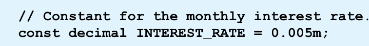
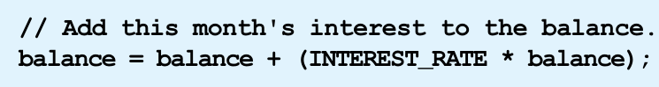
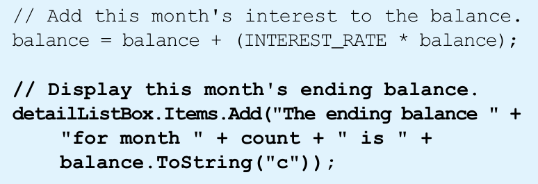
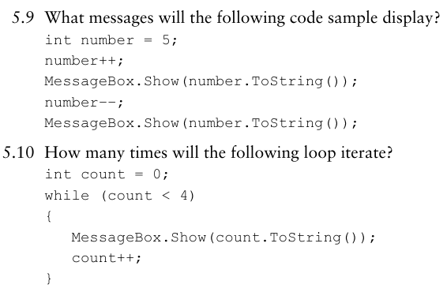

# Chapter 4 Code Screenshots

Every image below is copied directly from the supplied PowerPoint slide. No code screenshots have been recreated.

## slide-08-interest-rate.png

Slide 8: the monthly interest-rate constant used in the practice code.

## slide-08-balance-update.png

Slide 8: add the monthly interest amount to the balance.

## slide-09-ending-balance.png

Slide 9: update and display the ending balance.

## slide-11-increment-operator.png

Slide 11: increment a variable with the postfix operator.

## slide-11-decrement-operator.png

Slide 11: decrement a variable with the postfix operator.

## slide-12-postfix-example.png

Slide 12: original postfix example showing the value before and after incrementing.

## slide-12-prefix-example.png

Slide 12: original prefix example showing the value before and after incrementing.

## slide-13-operator-loop-checkpoint.png

Slide 13: checkpoint questions and code examples about operators and loop iteration.

