# C# Code Screenshots

This document lists every slide in the supplied presentation that contains visible C# code, a C# code structure, or a code-editor example. Each image is a full-slide screenshot so that the code and its surrounding explanation remain together. Slide numbers refer to the original PowerPoint order.

## Slide 26 — Introduction to C# Code

This slide shows the basic organization of a C# Windows Forms source file. The code is arranged inside a namespace, which contains a partial Form1 class, and the class contains the Form1 constructor. The constructor calls InitializeComponent(), which initializes the form and its controls. The slide also identifies the source code file in the Visual Studio editor.

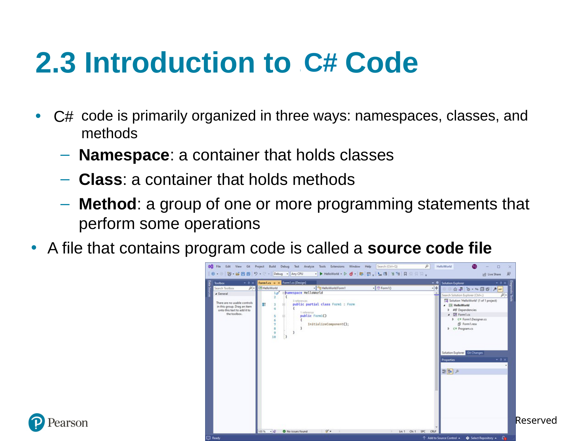

## Slide 29 — Organization of the Form1.cs

This slide breaks a sample Form1.cs file into three nested parts: the project namespace, the class declaration, and a method. The namespace groups the project code, the partial Form1 class derives from Form, and the Form1 constructor contains the InitializeComponent() call. The numbered diagram shows how the method sits inside the class and how the class sits inside the namespace.

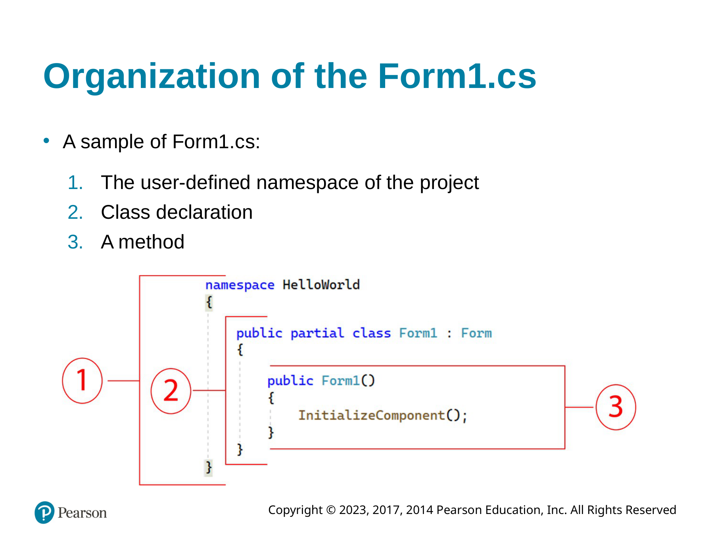

## Slide 30 — Adding Your Code

This slide introduces event-driven GUI applications. The program waits for an event, such as a mouse click, key press, or mouse movement, and then responds. Double-clicking a control in the Designer creates a default event handler. The shown handler signature uses the control name and event name, with object sender and EventArgs e as parameters; the method body is where the response code is written.

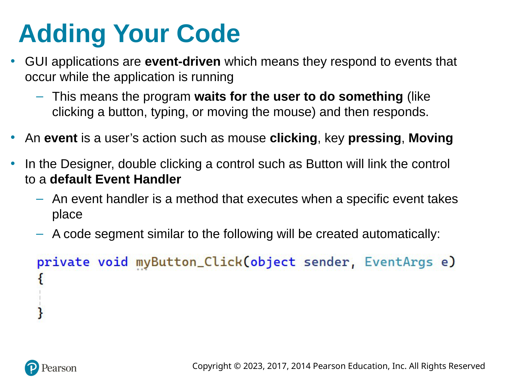

## Slide 31 — Message Boxes

This slide demonstrates the MessageBox.Show method supplied by .NET. The myButton_Click event handler calls MessageBox.Show("Thanks for clicking the button!"); so the message appears when the user clicks the button. The example connects a button click event to a simple dialog message.

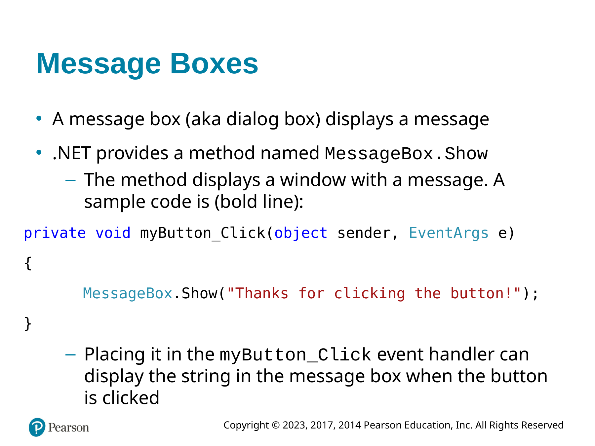

## Slide 32 — Writing Code for the Hello World Application

This slide presents the completed Form1.cs source code for the Hello World application. It includes the Hello World namespace, the partial Form1 class, the constructor and InitializeComponent() call, and a messageButton_Click event handler. When the button is clicked, MessageBox.Show("Hello World"); displays the message.

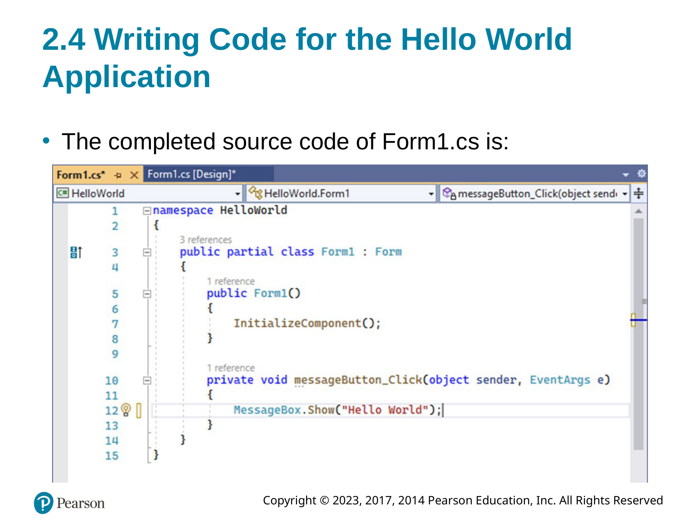

## Slide 35 — Using Code to Display Output in a Label Control

This slide shows how code in a button event handler can place output in a Label control by assigning a string to the label's Text property. It also explains the assignment operator: the receiving item goes on the left side of the equals sign. To clear a label, the example assigns an empty string with answerLabel.Text = "";.

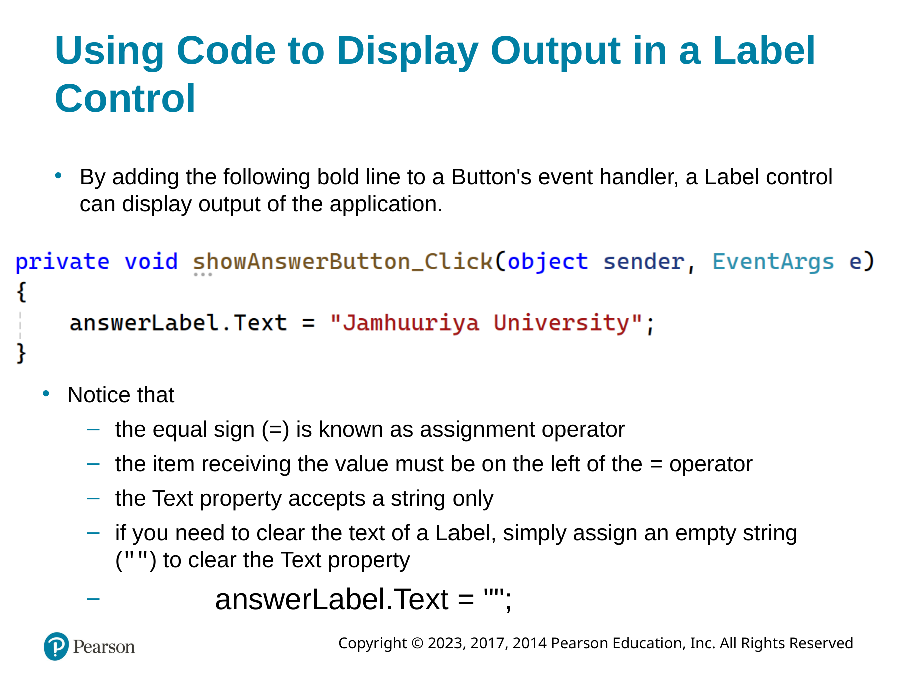

## Slide 36 — Making Sense of IntelliSense

This slide shows IntelliSense while code is being typed in an event handler. As the programmer enters the letters shown in the example, Visual Studio displays matching code-completion choices, including a label name. IntelliSense helps locate and insert available language elements such as keywords, variables, methods, classes, and properties.

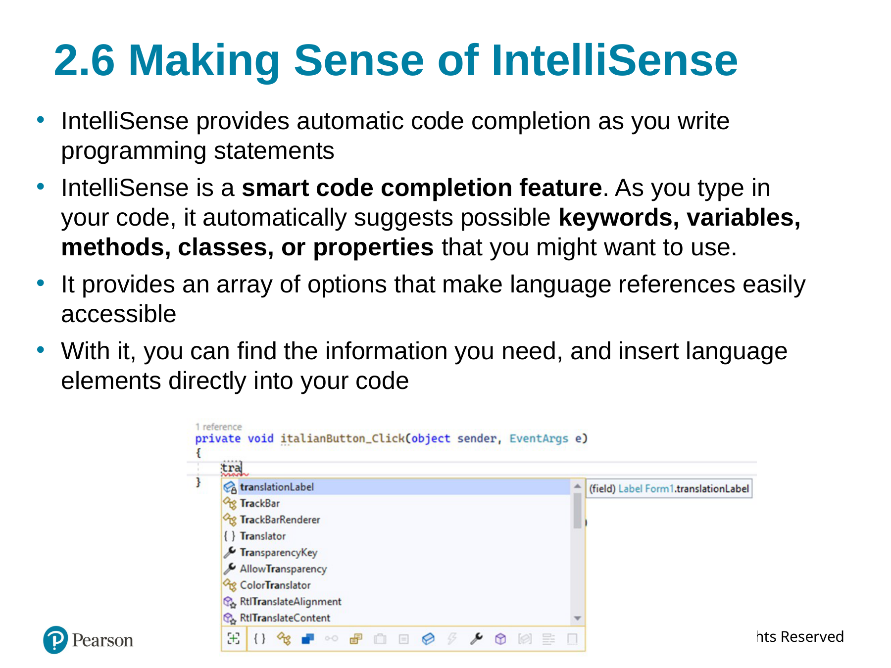

## Slide 38 — Creating Clickable Images

This slide demonstrates adding click behavior to a PictureBox. Double-clicking the PictureBox in the Designer creates a Click event handler. The examples show a message box in one handler and a PictureBox Visible property assignment in another, illustrating that an image control can respond to a click just like other controls.

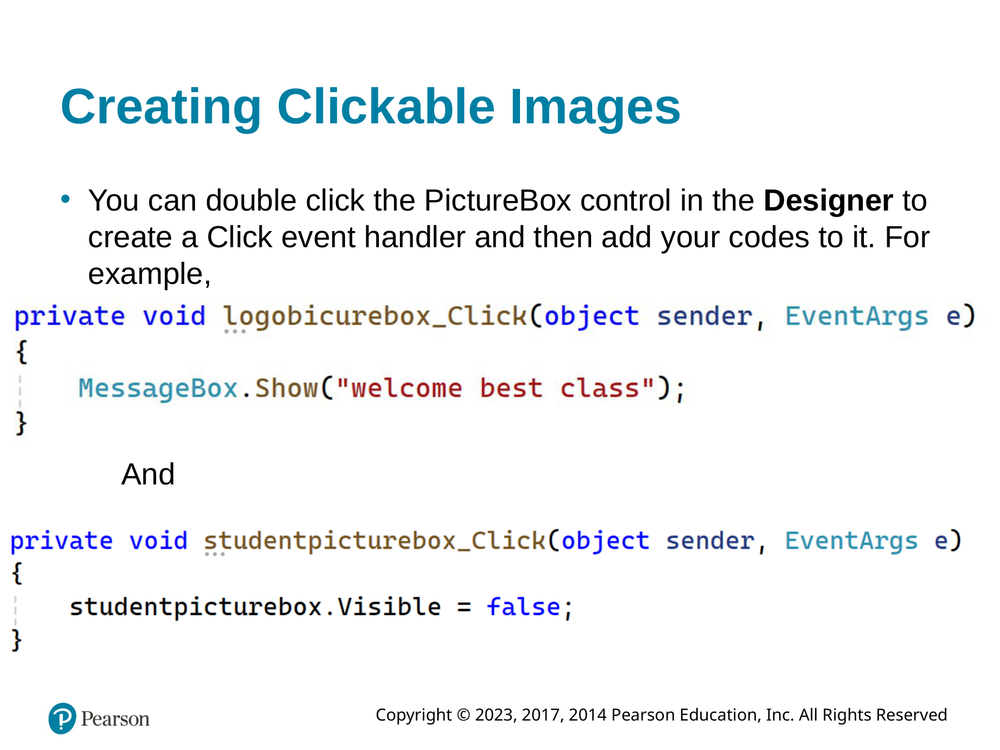

## Slide 39 — Sequential Execution of Statements

This slide demonstrates that statements in a method run in the order in which they appear. The correct example makes the card-back picture visible and the card-face picture hidden. The incorrect arrangement hides both pictures, so neither side of the card is shown. The comparison illustrates how statement order can create a logic error.

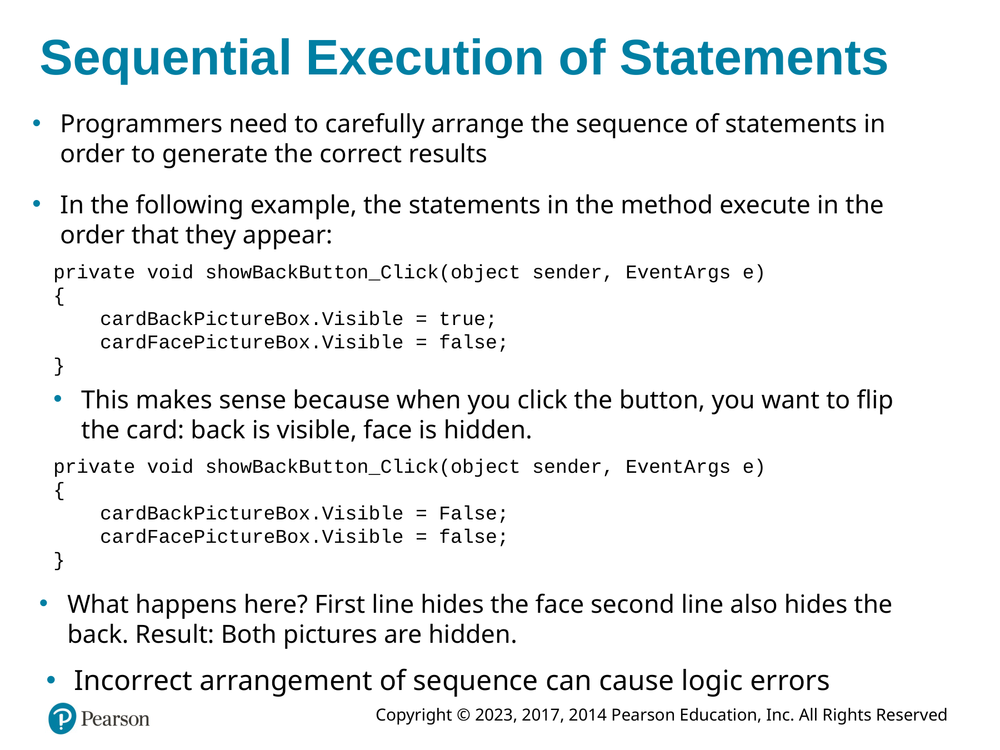

## Slide 40 — Comments, Blank Lines, and Indentation

This slide shows two C# comment forms. A line comment begins with // and explains the following statement, while a block comment is enclosed by /* and */ and can span multiple lines. The card example places a short comment before setting cardBackPictureBox.Visible to true.

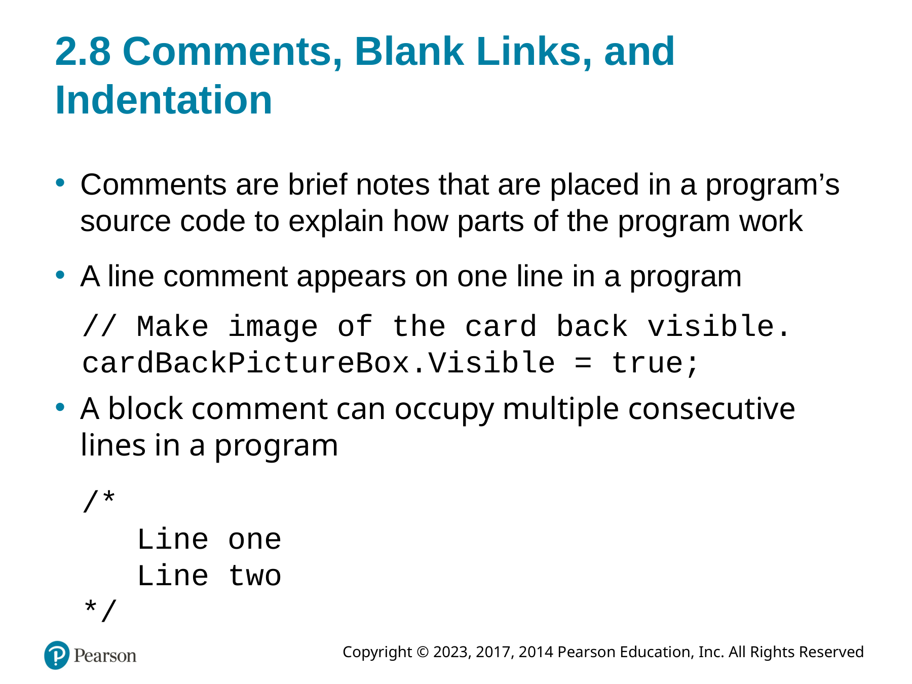

## Slide 41 — Using Blank Lines and Indentation (1 of 2)

This slide shows a formatted C# example for a Wage_Calculator form. Blank lines and indentation separate the namespace, Form1 class, constructor, and exitButton_Click event handler. The event handler contains a comment and calls this.Close() to close the current form. The slide explains that spacing makes code easier for people to read.

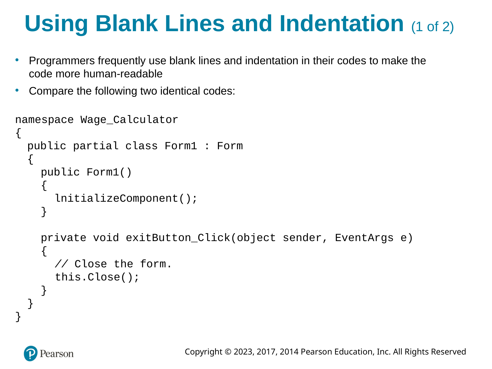

## Slide 42 — Using Blank Lines and Indentation (2 of 2)

This slide shows the same Wage_Calculator code with less visual spacing. The namespace, class, constructor, and exitButton_Click event handler are still present, and the handler still calls this.Close(). Comparing it with the previous slide demonstrates how blank lines and indentation improve readability without changing what the code does.

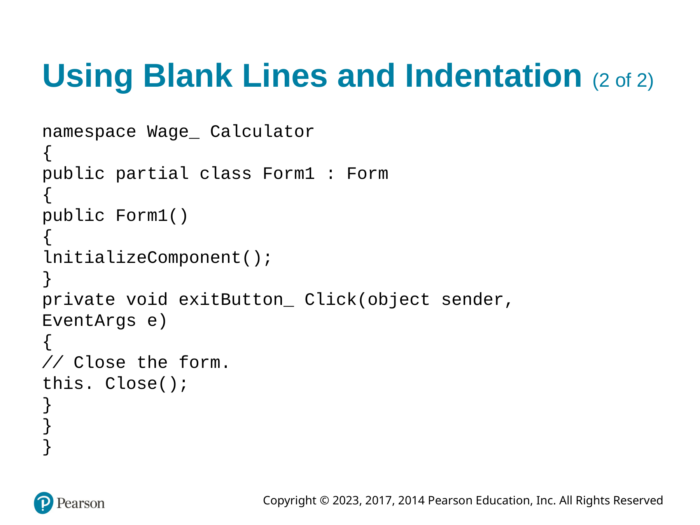

## Slide 43 — Writing the Code to Close an Application’s Form

This slide shows the code used to close a Windows Forms application form. The Exit button's click handler includes a comment and calls this.Close(); to close the current form. The slide also displays Application.Exit(); as a statement for closing the whole application.

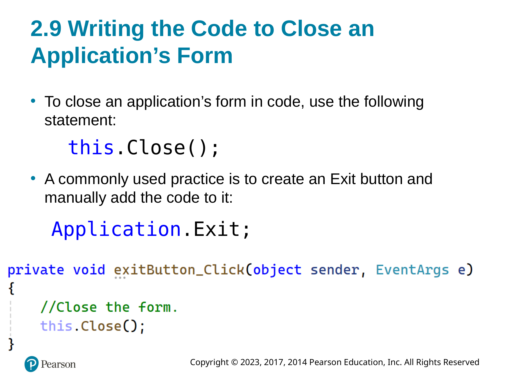

## Slide 44 — Dealing with Syntax Errors

This slide shows a syntax error in a button click handler. The method call is typed incorrectly as MessageBox.sho(...) rather than the MessageBox.Show method shown elsewhere in the chapter. Visual Studio marks the problem with a jagged underline, helping the programmer locate an invalid statement before or during compilation.

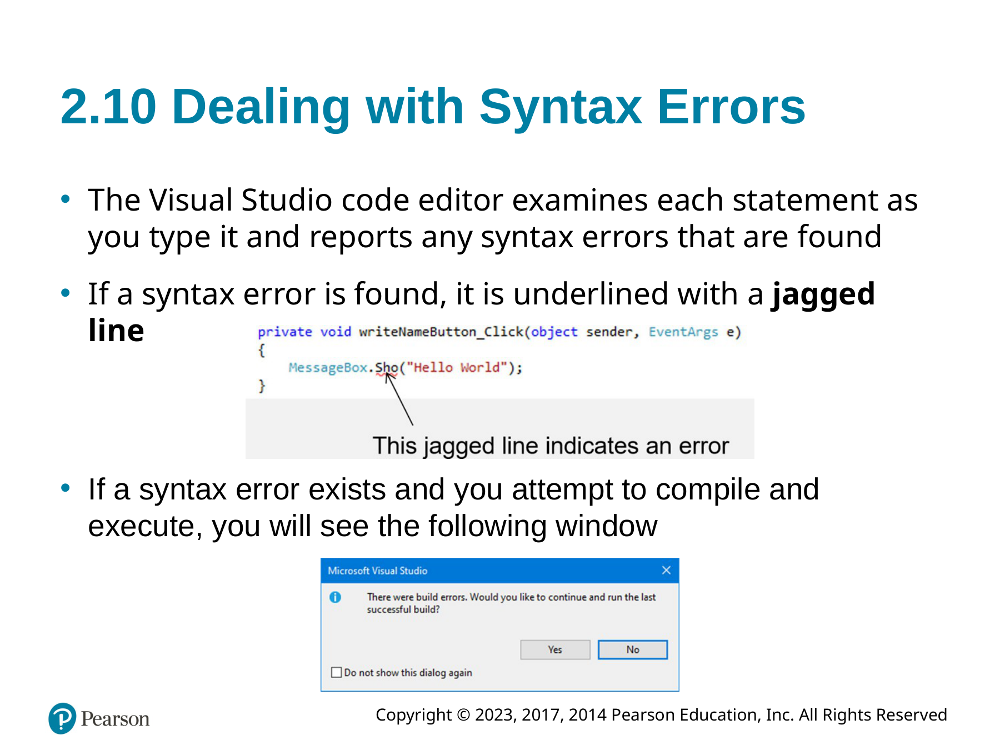

