# WEEK3 — Code Screenshots

**Source:** *Starting Out with Visual C#, Sixth Edition* — Chapter 3, “Making Decisions”.

**What is included:** 21 original, full-slide PNG screenshots from the supplied 34-slide PowerPoint. Each selected slide contains C# code, a code fragment, or a generic executable-code format. The screenshots are embedded directly below their explanations; there are no separate “Open screenshot” links.

## Code screenshots

### Slide 4 — A Simple Decision Structure — if statement

This slide introduces the single-alternative decision structure. It shows the general C# format of an `if` statement, including the Boolean expression in parentheses and the statements inside curly braces. The expression is evaluated as either true or false. When it is true, the statements in the block execute; when it is false, the block is skipped. The flowchart on the slide illustrates the one-path decision.

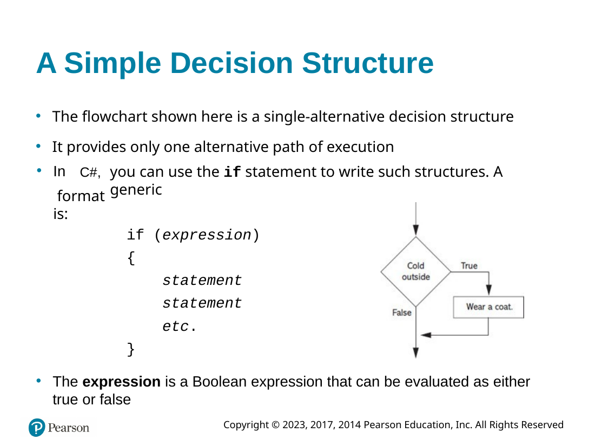

### Slide 6 — An if Statement with a Boolean Expression

This example tests whether `sales > 50000`. If the condition is true, the program assigns `500` to `bonus`. If the condition is false, the assignment is not performed. It demonstrates how a relational comparison becomes a Boolean expression that controls an `if` statement.

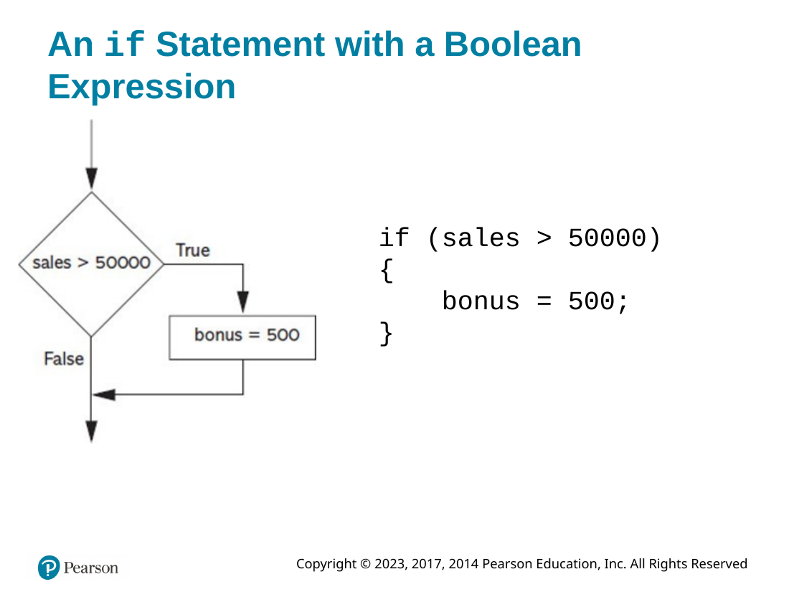

### Slide 7 — The if-else Statement

This slide gives the general syntax of `if-else`. The condition is checked once, and exactly one of the two blocks is selected: the `if` block when the expression is true, or the `else` block when it is false. The flowchart and sample structure show how the two alternative paths work.

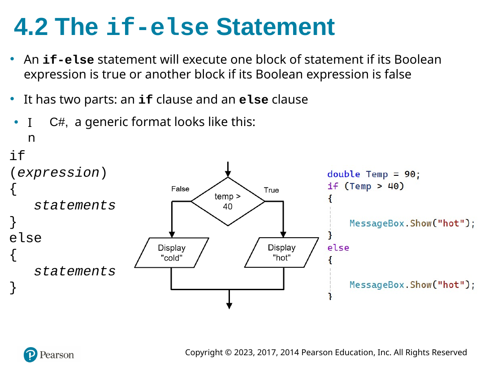

### Slide 9 — Practice Code — Test Score Average

This slide contains a complete event-handler code example for a test-score application. It reads values entered in TextBox controls, converts the entries to numeric values, calculates the average, and displays the result. It also compares the average with the high-score constant and uses exception handling to respond when the entered data cannot be processed. Keep the screenshot as the original code reference when studying the full example.

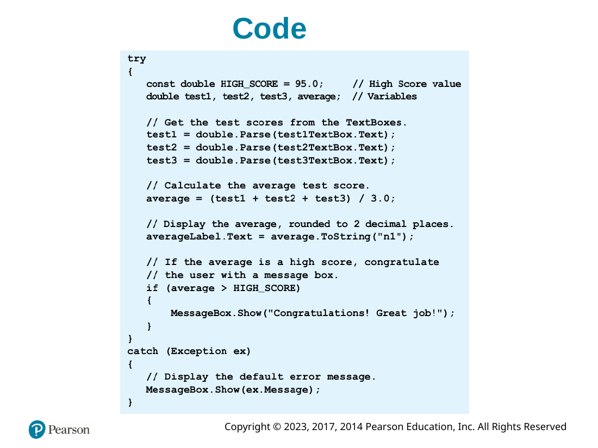

### Slide 11 — Nested Decision Structures

This slide shows the generic nested `if-else` structure. One decision is placed inside another decision block. The outer condition determines which path is followed, and an inner condition can then be tested within that path. This structure is useful when a program must evaluate more than one condition before selecting an action.

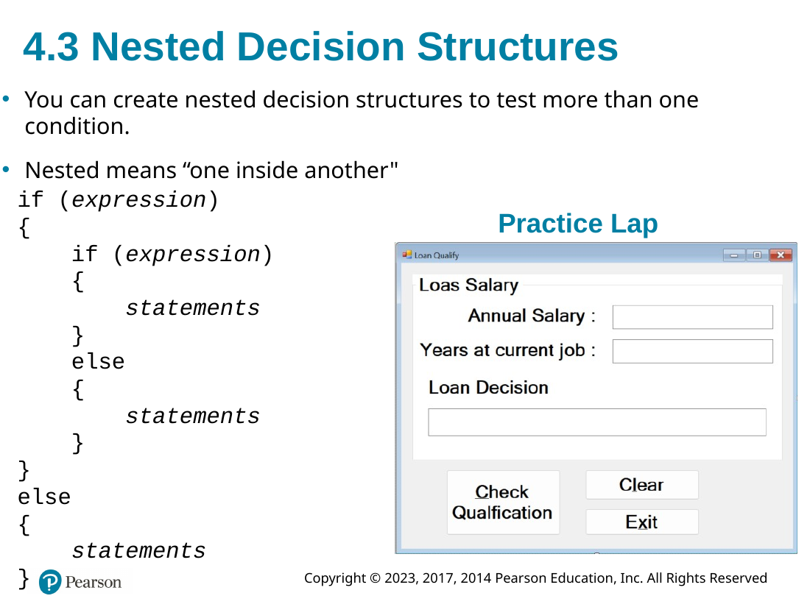

### Slide 12 — Example Nested Decision Structure

This slide presents a loan-qualification example using a flowchart and corresponding C# code. The decision process checks the applicant's salary and then checks how long the applicant has worked at the current job. The nested structure leads to different messages depending on whether the required conditions are satisfied. The screenshot preserves the flowchart and the code together.

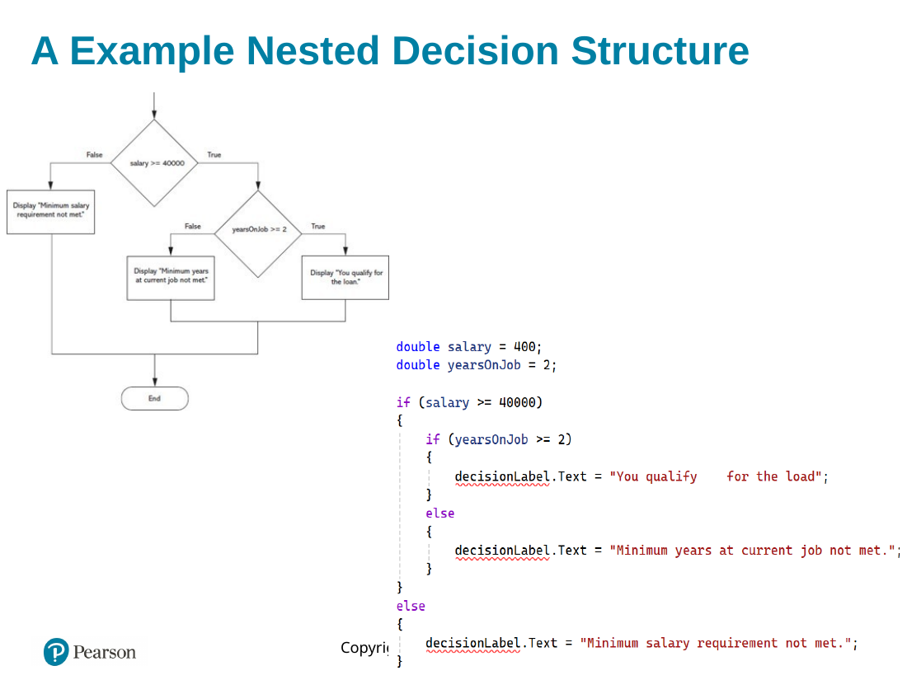

### Slide 13 — The if-else-if Statement

This slide shows the general format for checking several conditions in order. The first `if` condition is evaluated first. If it is false, the program checks the next `else if` condition, continuing until a condition is true. If none of the conditions is true, the final `else` block runs. The order of the conditions matters because the first true branch is selected.

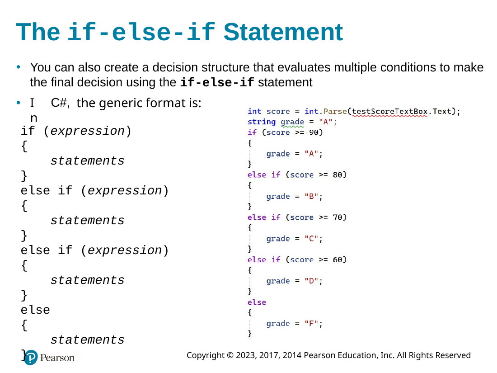

### Slide 17 — Sample Decision Structures with Logical Operators

This slide includes code examples for all three logical operators. The `&&` example requires both conditions to be true. The `||` example is true when at least one of its conditions is true. The `!` example reverses the result of the Boolean expression inside it. Each example uses `MessageBox.Show` to display a message when its condition is satisfied.

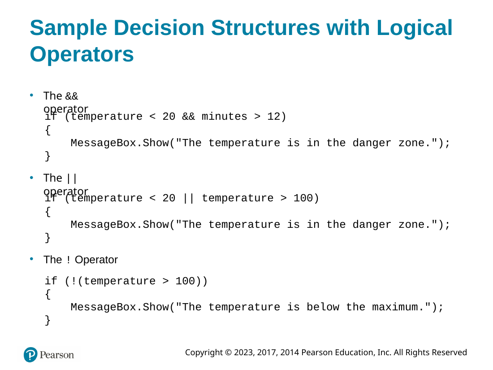

### Slide 18 — bool Variables and Flags

This slide introduces `bool` variables, which can store only `true` or `false`, and explains their use as flags. The code example declares and changes Boolean values and uses a flag to record whether a condition has occurred. A false flag means the condition is not present; a true flag signals that it is present. This is a common way for a program to remember a state.

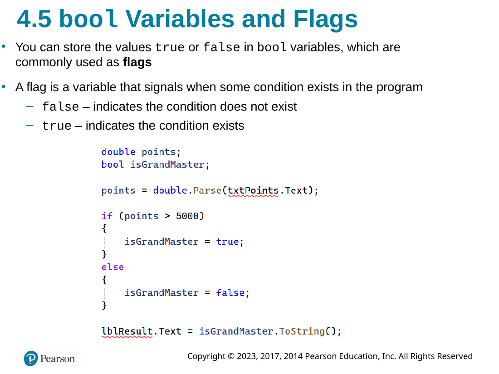

### Slide 19 — Comparing Strings

This slide demonstrates three ways to compare string values: the `==` operator, the `!=` operator, and the `String.Compare` method. The examples compare two string variables or compare a variable with a string literal. With `String.Compare`, a result of zero indicates that the two strings compare as equal. The screenshot preserves the exact examples shown in the presentation.

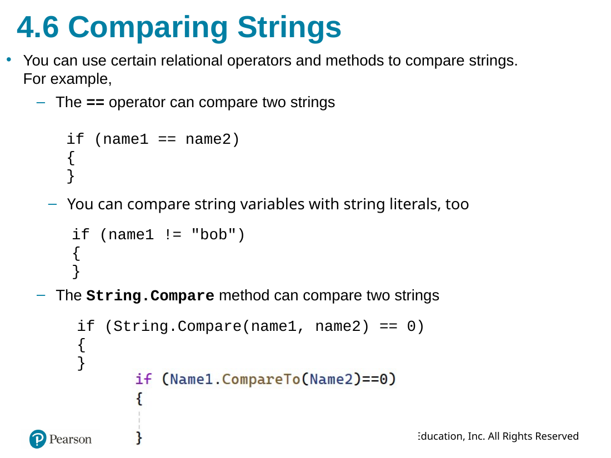

### Slide 20 — Preventing Data Conversion Exceptions with TryParse

This slide introduces `int.TryParse`, `double.TryParse`, and `decimal.TryParse`. It gives the general syntax `dataType.TryParse(string input, out targetVariable)`. The method attempts to convert the input text and reports whether the conversion succeeded. The `out` keyword is required because the converted value is placed in the target variable.

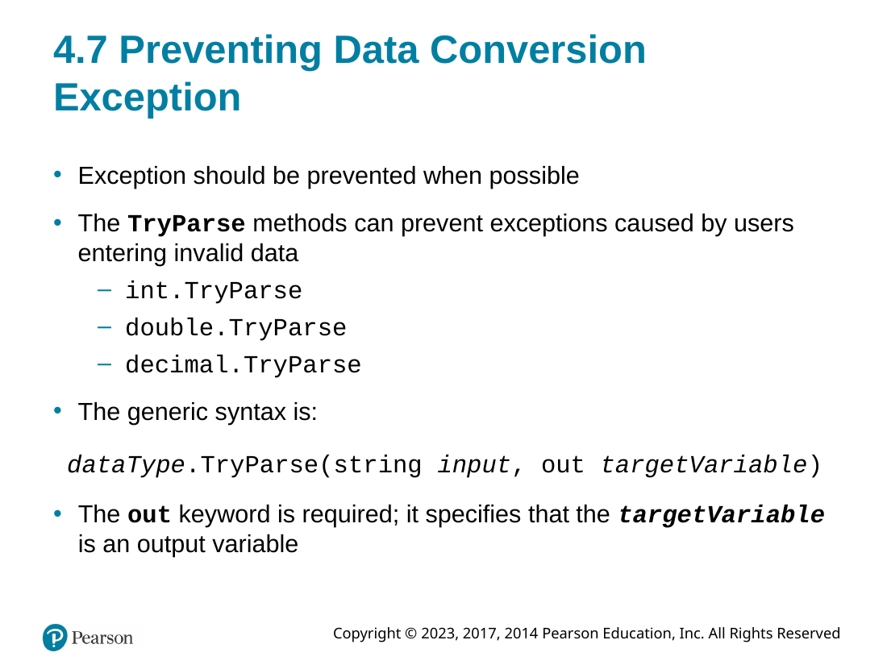

### Slide 21 — Input Validation

This slide distinguishes converting input from validating it. `TryParse` can establish whether text can be converted to a number, but the program must still check whether the number is within an acceptable range. The slide gives examples for hours worked (`hours > 0 && hours <= 168`) and test scores (`testScore >= 0 && testScore <= 100`), as well as an `int.TryParse` code fragment.

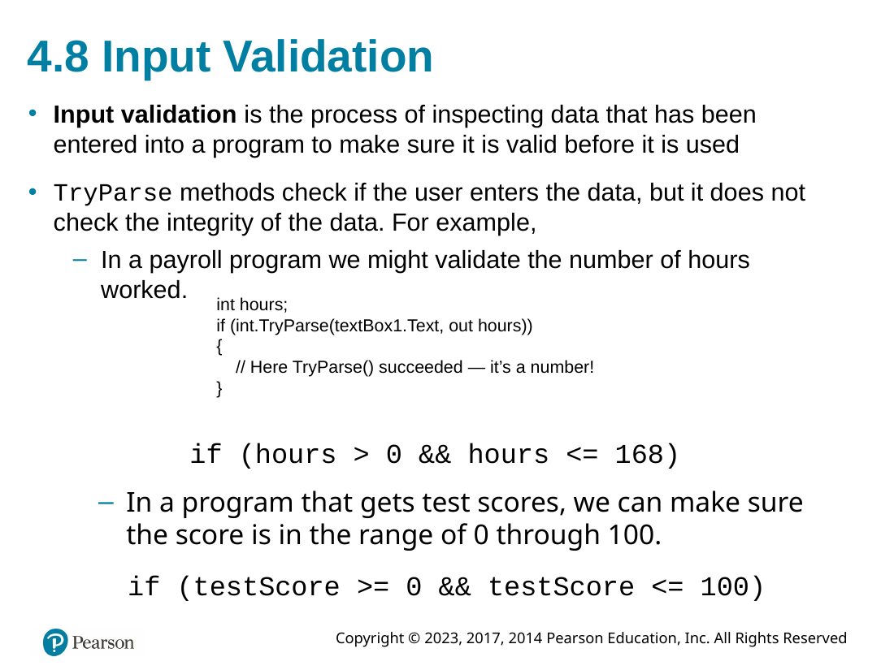

### Slide 23 — RadioButton Control

This slide explains the RadioButton control's `Text` and `Checked` properties and shows how to test whether a radio button is selected. The first example uses the Boolean `Checked` property directly in an `if` statement. The second example compares it with `true`; the slide notes that this is equivalent, although the direct form is shorter.

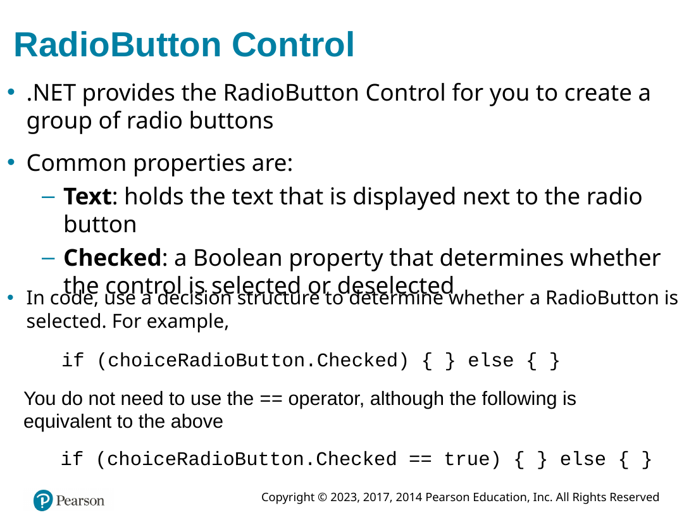

### Slide 24 — CheckBox Control

This slide explains the CheckBox control and its `Text` and `Checked` properties. The code uses an `if-else` statement to determine whether the check box is selected, allowing the program to respond differently when the option is checked or unchecked. Unlike radio buttons in one group, check boxes can be selected independently.

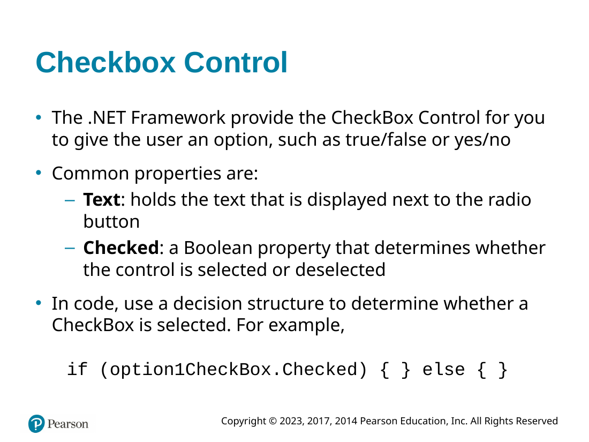

### Slide 25 — The CheckedChanged Event

This slide shows the method signature for a `CheckedChanged` event handler. The event is raised when a RadioButton or CheckBox control's `Checked` property changes. Double-clicking the control in the Designer creates the event-handler method, and the statements written inside its braces run in response to that change.

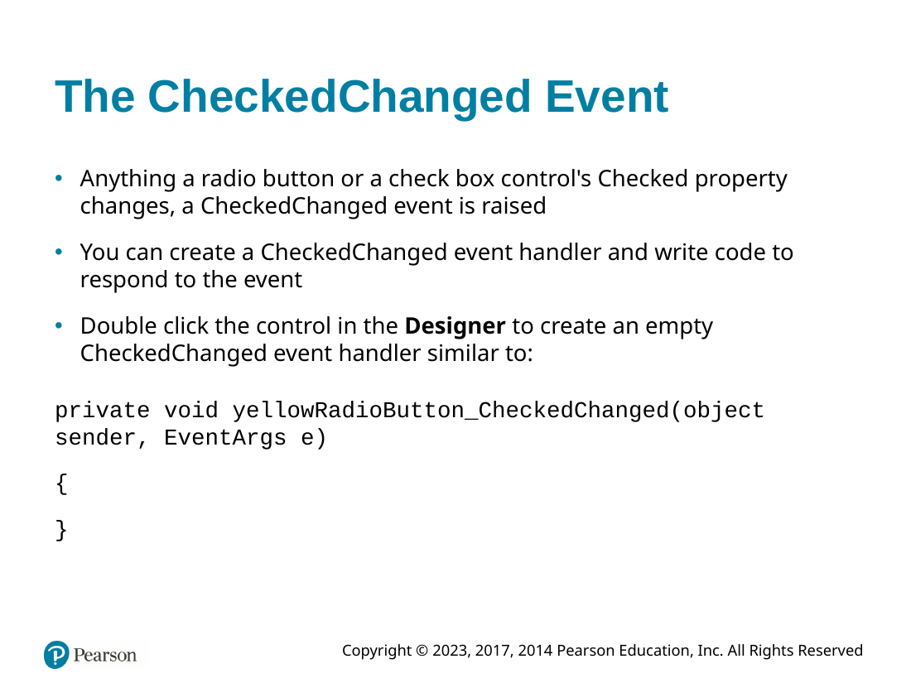

### Slide 26 — The switch Statement

This slide presents the general syntax of a `switch` statement. The program evaluates `testExpression` and compares its value with the values listed in the `case` labels. The statements under a matching case execute, and `break` exits the switch statement. The optional `default` section handles a value that does not match any listed case.

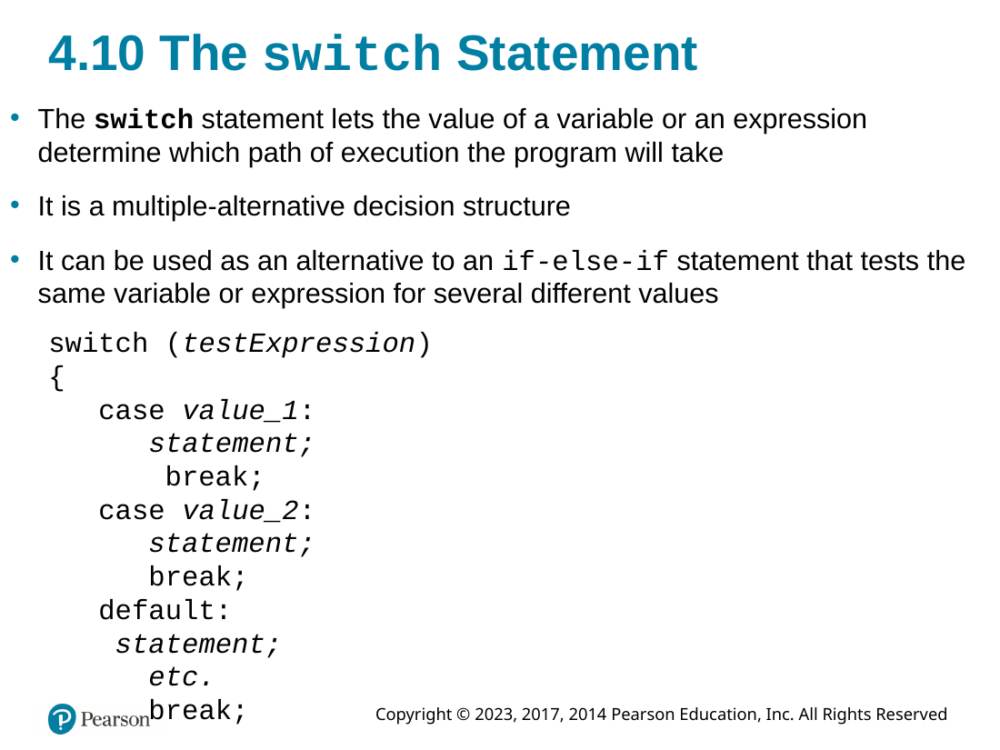

### Slide 28 — Introduction to List Boxes — Properties and SelectedItem

This slide describes ListBox properties and includes code for retrieving the selected item. It covers `Text`, `Items`, `Items.Count`, `SelectedItem`, and `SelectedIndex`. The code example converts `fruitListBox.SelectedItem` to a string and stores it in a variable. These properties let a program inspect the contents of the ListBox and work with the user's current selection.

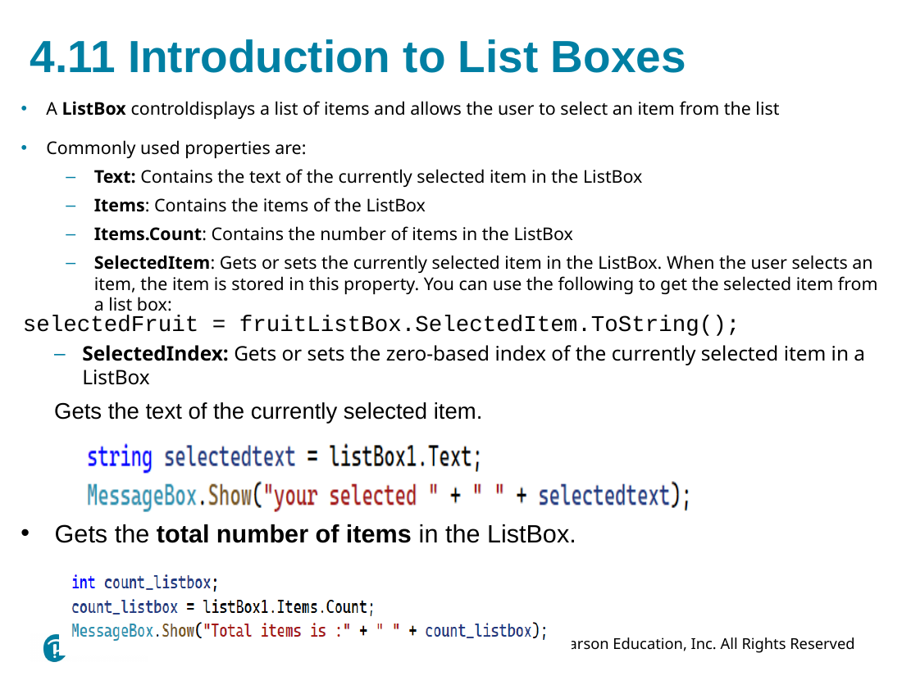

### Slide 29 — Adding Items to a ListBox

This slide gives the general `ListBox.Items.Add(NewItem)` syntax and shows three statements that add Monday, Tuesday, and Wednesday to `daysListBox`. Each call adds one item to the ListBox. The screenshot includes both the general format and the specific examples.

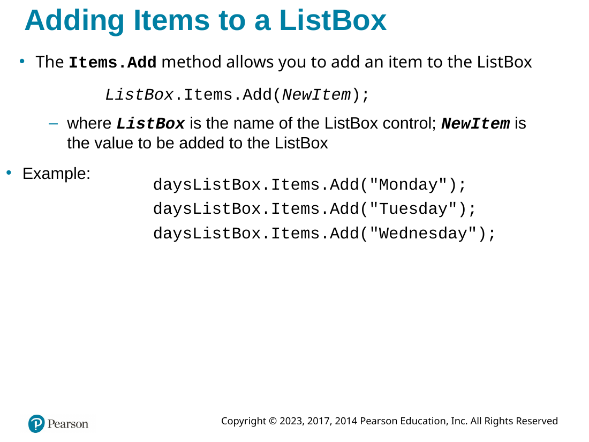

### Slide 30 — SelectedItem and SelectedIndex

This slide warns that accessing `SelectedItem` when no item is selected can cause an exception. ListBox indexes start at zero, so the first item has index 0 and the nth item has index n − 1. When nothing is selected, `SelectedIndex` is −1. The code checks that the selected index is not −1 before reading the selected item.

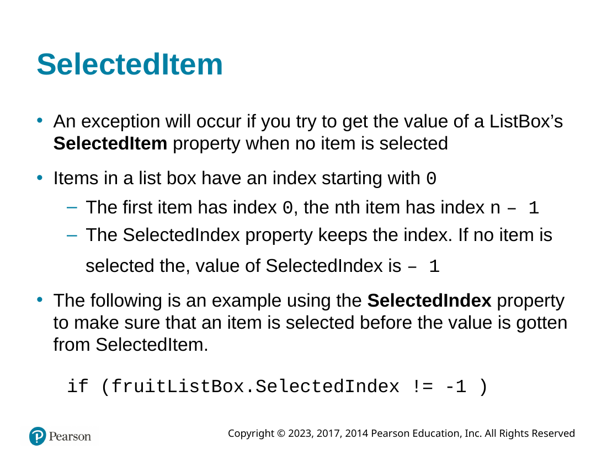

### Slide 32 — Removing a Specific Item from a ListBox

This slide explains `Items.Remove`, which removes a particular item by its value. It gives the general syntax `ListBox.Items.Remove(Item)` and the example `daysListBox.Items.Remove("Tuesday")`. This method is used when the program knows the item value that should be removed.

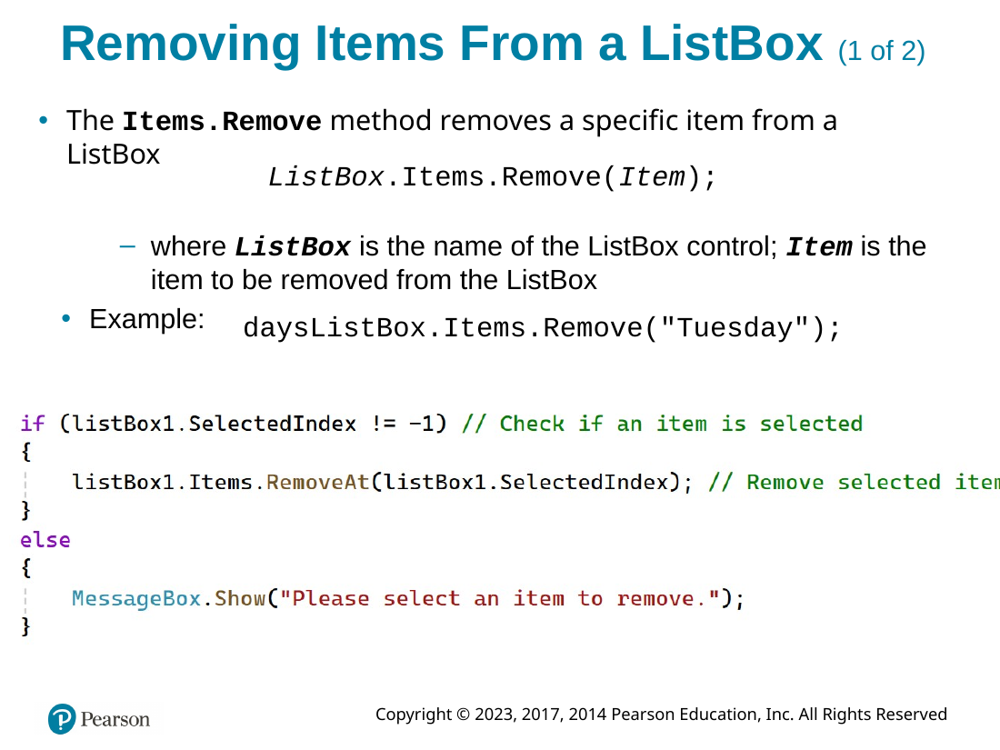

### Slide 33 — Removing by Index and Clearing a ListBox

This slide covers two ListBox methods. `Items.RemoveAt(Index)` removes the item at a specified zero-based index, while `Items.Clear()` removes every item from the ListBox. It also warns that the index passed to `RemoveAt` must be valid; an invalid index causes an exception. Both example statements are visible in the original screenshot.

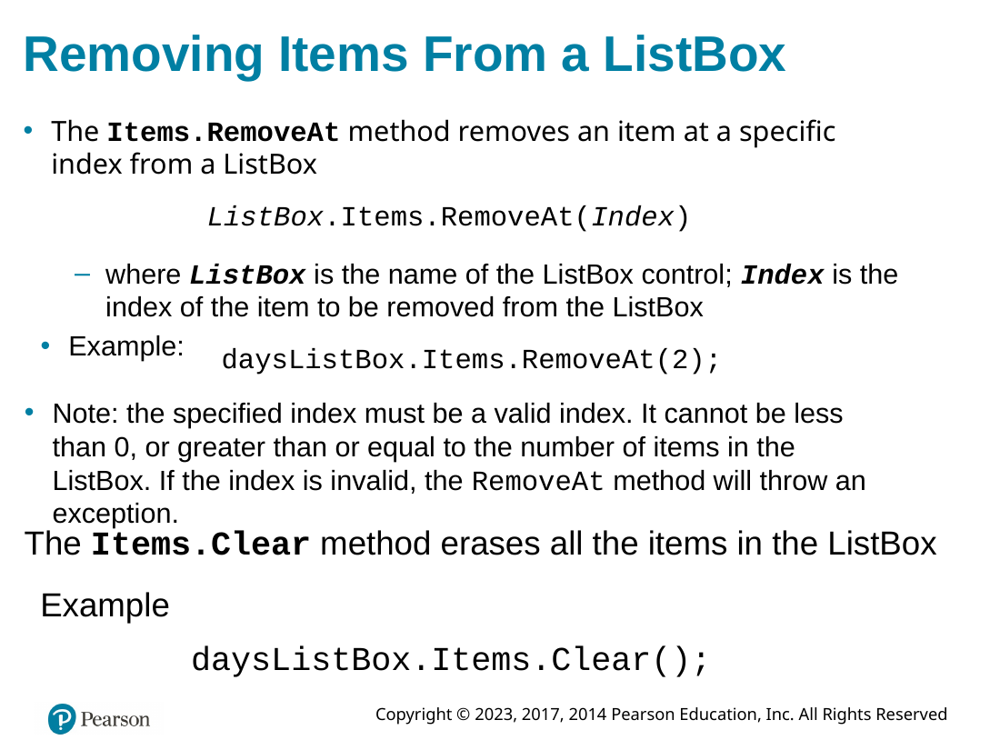

## Verification note

All 34 slides in the supplied presentation were reviewed. Slides without code were not placed in the code-screenshot folder. These include the title/topics slides, concept-only explanations, relational/logical truth tables, practice/application interface screenshots, and the Text-versus-SelectedItem comparison table on slide 31. This prevents non-code slides from being presented as code examples.

---

