# Chapter 4 Code Screenshots

These screenshots cover the loop and increment/decrement examples before the Files section.

## 04-while-structure.png

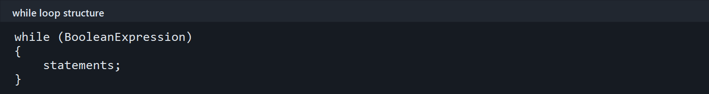

Basic while syntax tests a Boolean expression before running the loop body.

## 05-while-counter.png

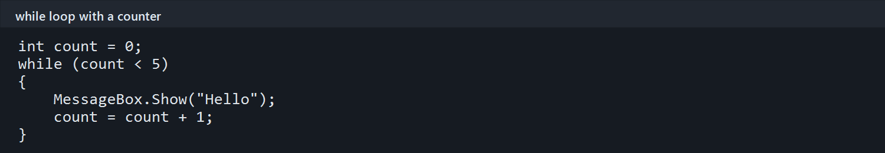

A counter-controlled while loop displays a message five times.

## 06-while-condition-false.png

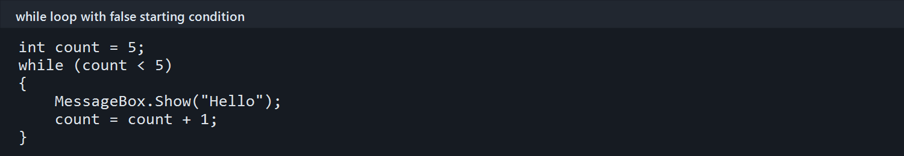

The loop condition starts false, so the body is skipped.

## 07-infinite-loop-example.png

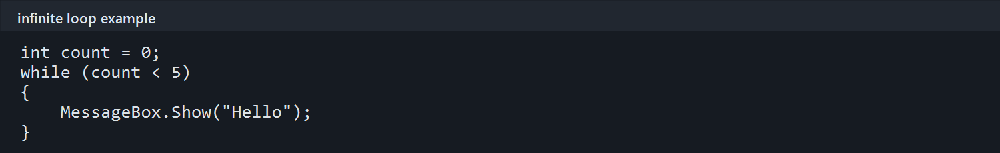

An infinite-loop example where the counter is never updated.

## 10-increment-decrement.png

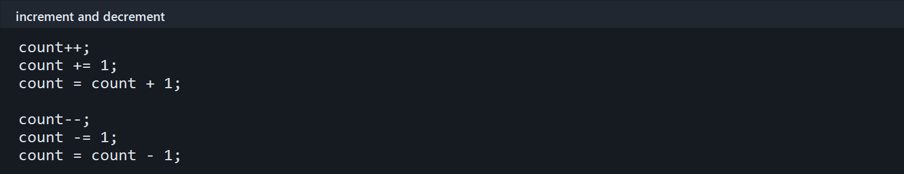

Equivalent ways to increase or decrease a variable by one.

## 11-postfix-example.png

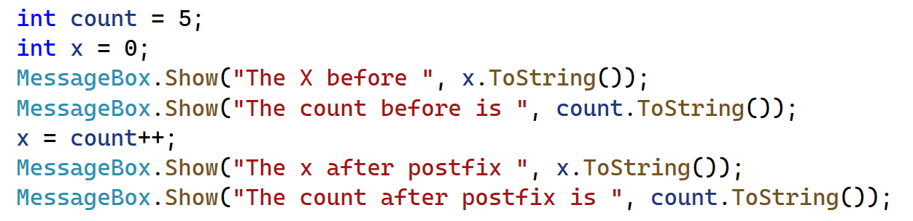

The postfix example uses the original value before incrementing.

## 12-prefix-example.png

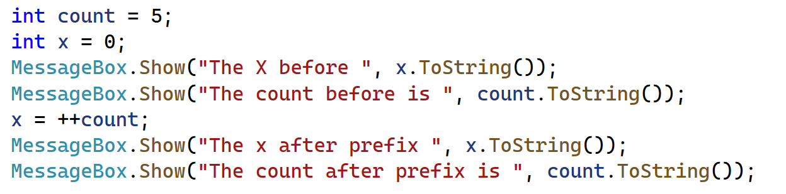

The prefix example increments first and then uses the new value.

## 12-prefix-postfix-operators.png

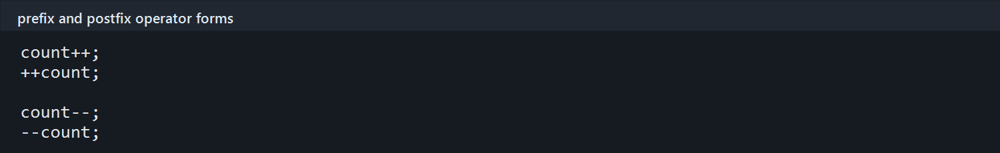

Prefix and postfix forms of the increment and decrement operators.

## 13-for-loop-template.png

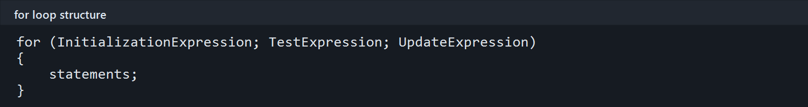

The initialization, test, and update parts of a for loop.

## 14-for-loop-counter.png

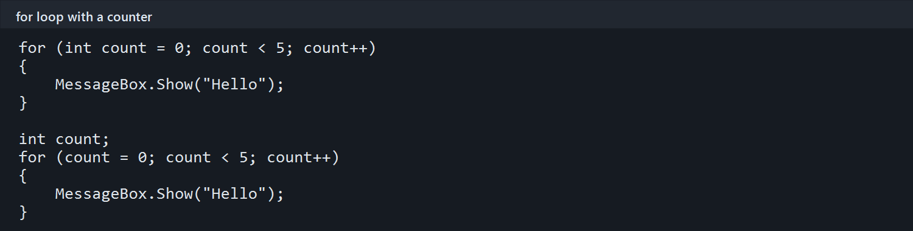

Two equivalent for loop examples using a counter variable.

## 15-for-loop-updates.png

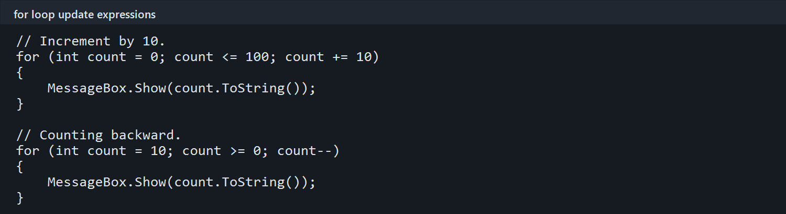

A for loop counting upward by ten and another counting backward.

## 16-do-while-template.png

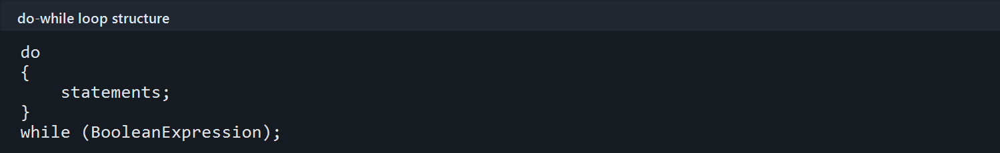

General syntax for a posttest do-while loop.

## 17-do-while-example.png

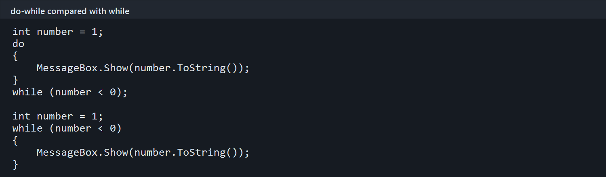

Comparison of do-while and while when the condition is false initially.

