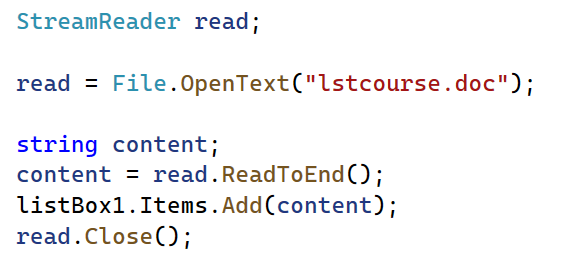
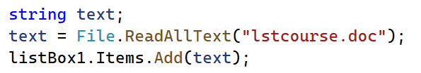
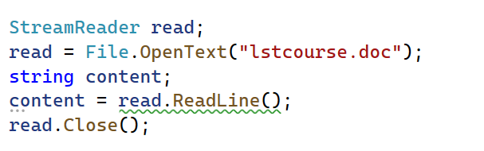
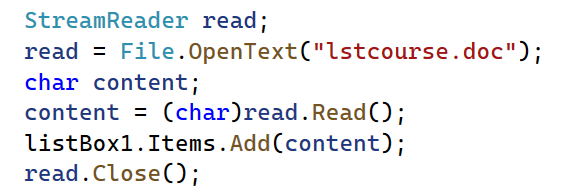
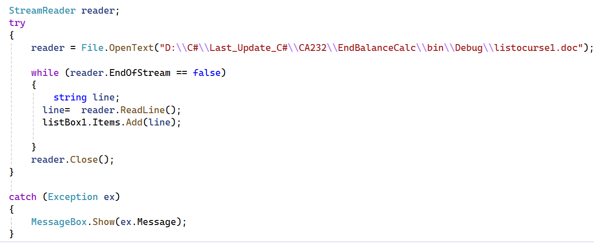
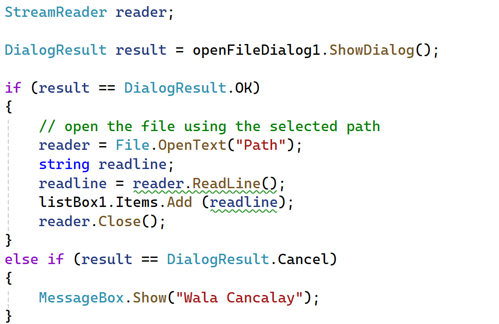
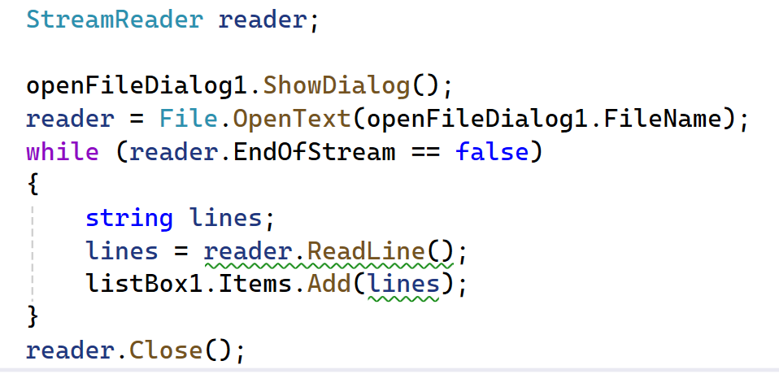

# Chapter 5 Code Screenshots

Every image below is copied directly from the supplied PowerPoint slide. No code screenshots have been recreated.

## slide-28-read-to-end.png

Slide 28: read file contents to the end and add the result to a list box.

## slide-28-read-all-text.png

Slide 28: read a whole text file with the file-reading example.

## slide-28-read-line.png

Slide 28: read one line from the text file.

## slide-28-read-character.png

Slide 28: read one character from the text file.

## slide-30-read-until-eof.png

Slide 30: loop through file lines until the end of the stream.

## slide-34-dialog-result.png

Slide 34: handle the selected result from the Open dialog.

## slide-36-open-selected-file.png

Slide 36: open the file selected in the Open dialog.

